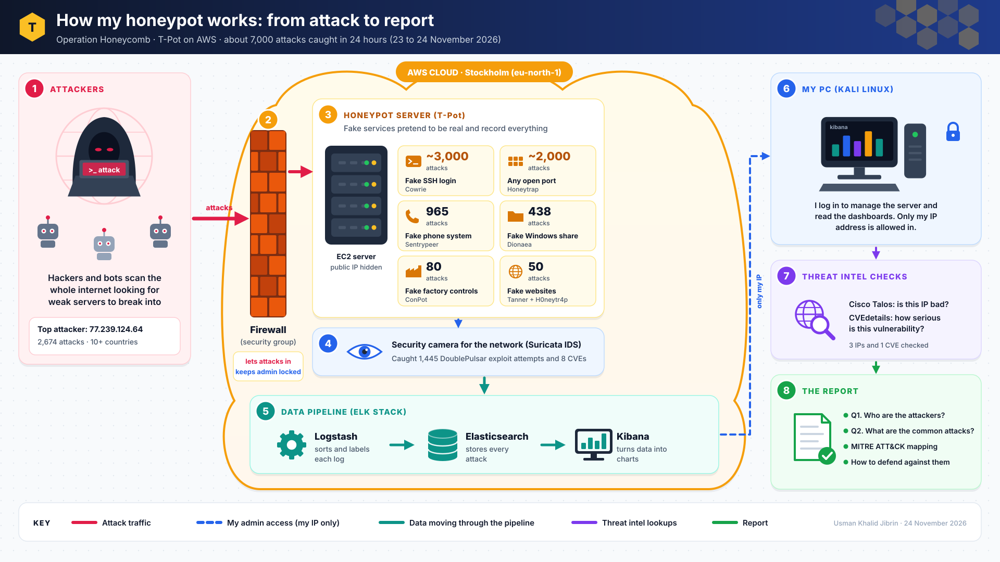

# Operation Honeycomb: 24 Hour T-Pot Honeypot Threat Intelligence

**Author:** Usman Khalid Jibrin · **Completed:** 24 November 2026

I deployed a T-Pot honeypot on AWS, left it open to the internet for about 24 hours, and turned roughly **7,000 attacks** into a threat intelligence report. This page is a short summary. The full write-up is in the `report` folder.

## Key findings

- **About 7,000 attacks in 24 hours**, from sources in 10 or more countries.
- **SSH brute forcing was the biggest activity.** The most tried login was `root` / `123456`.
- **One IP (77.239.124.64) sent over a third of all attacks** and is on the Cisco Talos block list.
- **Old exploits are still everywhere.** The top IDS alert was DoublePulsar (1,445 alerts), and the most common vulnerability was CVE-2002-0013 (CVSS 10.0, from 2002).
- **Weak passwords and unpatched services** explain almost everything, so basic hardening would stop most of it.

## The two questions

- **Q1. Who are the attackers?** Mostly automated bots on rented cloud servers, plus some compromised home devices. See the report, section 10.
- **Q2. What are the common attacks?** SSH brute force, port scanning, VoIP abuse, SMB exploits and old CVEs. See the report, section 11.

## What's in this repo

| Folder | Contents |
| --- | --- |
| [`report/`](report/) | The full report (PDF) |
| [`docs/`](docs/) | Detailed write-ups: architecture, deployment, analysis, enrichment, MITRE, recommendations |
| [`data/`](data/) | The dashboard tables as CSV |
| [`diagrams/`](diagrams/) | The architecture graphics and their source |
| [`screenshots/`](screenshots/) | Evidence from Kibana, Talos and the Hydra test (details redacted) |

## Tools

T-Pot 24.04.1, AWS EC2, Suricata, P0f, the Elastic stack (Elasticsearch, Logstash, Kibana), Kali Linux, Cisco Talos, CVEdetails.com and the MITRE ATT&CK framework.

## Ethics

The honeypot only listened and recorded. Admin access was limited to my own IP, and the one brute force test (Hydra) was run against my own server. Account details and IP addresses are redacted in the screenshots. Attacker IPs are shown as findings, not as accusations.

## License

Released under the MIT License. See [LICENSE](LICENSE).
