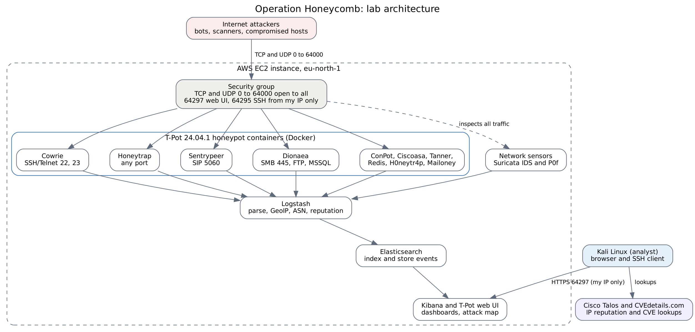
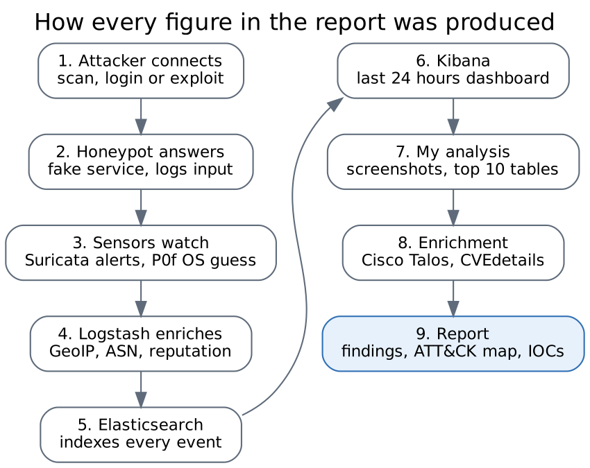

# 1. Architecture

[Back to README](../README.md)

## Overview

The lab has three parts:

1. **The attackers.** Anyone on the internet. In practice this means automated scanners, botnets and compromised machines.
2. **The honeypot server.** One AWS EC2 instance in eu-north-1 running T-Pot 24.04.1. Everything on it runs in Docker containers.
3. **The analyst machine.** My Kali Linux laptop, used to manage the server over SSH and read the dashboards in a browser.

## Components

### Network layer

The AWS security group decides what can reach the instance. Honeypot ports (TCP and UDP 0 to 64000) are open to everyone so attackers can find them. The two management ports are treated differently:

| Port | Service | Who can reach it |
| --- | --- | --- |
| 64295 | Real SSH (T-Pot moves it here from 22) | My IP only |
| 64297 | T-Pot web UI, Kibana and tools over HTTPS | Everyone in this test, protected by a password. I would restrict this to my IP next time |

### Honeypot layer

Each honeypot is a container that pretends to be a real service.

| Honeypot | Pretends to be | Why attackers care |
| --- | --- | --- |
| Cowrie | SSH and Telnet server | Shell access to Linux machines |
| Honeytrap | Anything on a port with no dedicated honeypot | Catches general scanning |
| Sentrypeer | SIP VoIP server | Toll fraud |
| Dionaea | SMB, FTP, MSSQL and other Windows services | Worms such as WannaCry and EternalBlue tools |
| ConPot | Industrial control systems | Finding exposed factory or utility equipment |
| Ciscoasa | Cisco ASA VPN portal | Known firewall exploits |
| Tanner | Web application | Web attacks such as path traversal and injection |
| Redishoneypot | Redis | Unauthenticated databases used for cryptomining |
| H0neytr4p | Web server | Web exploit attempts |
| Mailoney | SMTP server | Open relays for spam |

### Sensor layer

* **Suricata** reads all traffic on the network interface and matches it against the Emerging Threats rule set. When a rule matches it raises an alert, and if the rule is tied to a CVE that CVE is recorded.
* **P0f** looks at how a sender builds its TCP packets and guesses its operating system without sending anything back.

### Data layer

* **Logstash** collects every log file, parses it into fields, and enriches it with country, ASN and T-Pot's IP reputation tags.
* **Elasticsearch** stores the events and makes them searchable by time, IP, port and honeypot.
* **Kibana** reads Elasticsearch and draws the T-Pot dashboard.

### Analysis layer

* **Kibana dashboard** with the time filter set to the last 24 hours.
* **Cisco Talos** for IP reputation, owner and block list status.
* **CVEdetails.com** for CVSS, EPSS and CWE information.

## Data flow

| Step | What happens | Where it shows in the report |
| --- | --- | --- |
| 1 | Attacker connects to an open port | Every chart |
| 2 | Honeypot answers and logs the session | Honeypot totals, username and password clouds |
| 3 | Suricata and P0f observe the packets | Signature table, CVE table, P0f OS chart |
| 4 | Logstash adds GeoIP, ASN and reputation | Country charts, ASN table, reputation chart |
| 5 | Elasticsearch indexes the event | Histograms over time |
| 6 | Kibana draws the dashboard | All screenshots |
| 7 | I read each panel and take screenshots | Findings sections |
| 8 | I enrich with Talos and CVEdetails | Enrichment section |
| 9 | I write up the report | `report/` folder |
