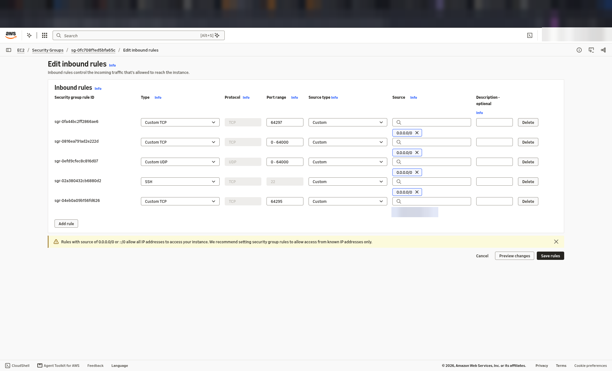
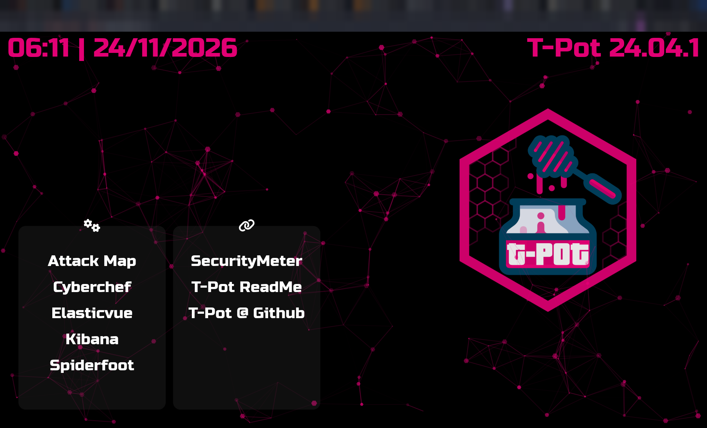

# 2. Deployment guide

[Back to README](../README.md)

These are the steps I followed, written so someone else can repeat the project. Check the [official T-Pot README](https://github.com/telekom-security/tpotce) for current system requirements and supported operating systems before you start, because they change between releases.

## Step 1. Launch the EC2 instance

1. Sign in to the AWS console and switch to the region you want (I used **eu-north-1, Stockholm**).
2. Launch an instance with a Linux distribution that T-Pot supports.
3. Pick an instance size with enough memory and disk for T-Pot's full install. T-Pot runs many containers plus the ELK stack, so a small free tier instance will not cope.
4. Create or select a key pair for SSH.
5. Start with a security group that only allows SSH (22) from **your own IP**. You will open the honeypot ports later.

## Step 2. Install T-Pot

Connect from Kali:

```bash
ssh -i your-key.pem <user>@<public-ip>
```

Then follow the installer in the T-Pot README. In short:

```bash
git clone https://github.com/telekom-security/tpotce
cd tpotce
./install.sh
```

Choose the standard (Hive) installation, set a web username and password, and reboot when it finishes.

After the reboot T-Pot moves the real SSH service to **port 64295**, so reconnect with:

```bash
ssh -i your-key.pem -p 64295 <user>@<public-ip>
```

## Step 3. Configure the security group

Replace the temporary rules with these:

| Type | Protocol | Ports | Source | Purpose |
| --- | --- | --- | --- | --- |
| Custom TCP | TCP | 0 to 64000 | 0.0.0.0/0 | Honeypots on TCP |
| Custom UDP | UDP | 0 to 64000 | 0.0.0.0/0 | Honeypots on UDP |
| Custom TCP | TCP | 64295 | your IP /32 | Real SSH |
| Custom TCP | TCP | 64297 | your IP /32 | Web UI and Kibana |

> In my run, port 64297 was open to 0.0.0.0/0. It still needed a password, but restricting it to your own IP is safer. A separate rule for port 22 is not needed because 0 to 64000 already includes it.



## Step 4. Open the web UI

Browse to `https://<public-ip>:64297` and log in. The browser warns about the certificate because T-Pot uses a self signed one. That is expected.



From the landing page you can open the Attack Map, CyberChef, Elasticvue, Kibana and Spiderfoot.

## Step 5. Collect data

Leave the honeypot running. Attacks start within minutes. In Kibana, open **Dashboards, T-Pot** and set the time picker to **Last 24 hours**.

## Step 6. Capture evidence

Before shutting down, take screenshots of:

* The honeypot totals, histograms and attack map
* The reputation, honeypot, P0f and country pie charts
* The username and password tag clouds
* The top 10 tables (ASN, source IP, Suricata CVE, Suricata signature)

Exporting the raw data from Kibana (Discover, then Share, then CSV) is worth doing too, so exact numbers are available later.

## Step 7. Shut down

When finished, stop or terminate the instance so you are not billed and the honeypot is not left unattended. Blur your AWS account ID and personal IP before publishing any screenshots.
