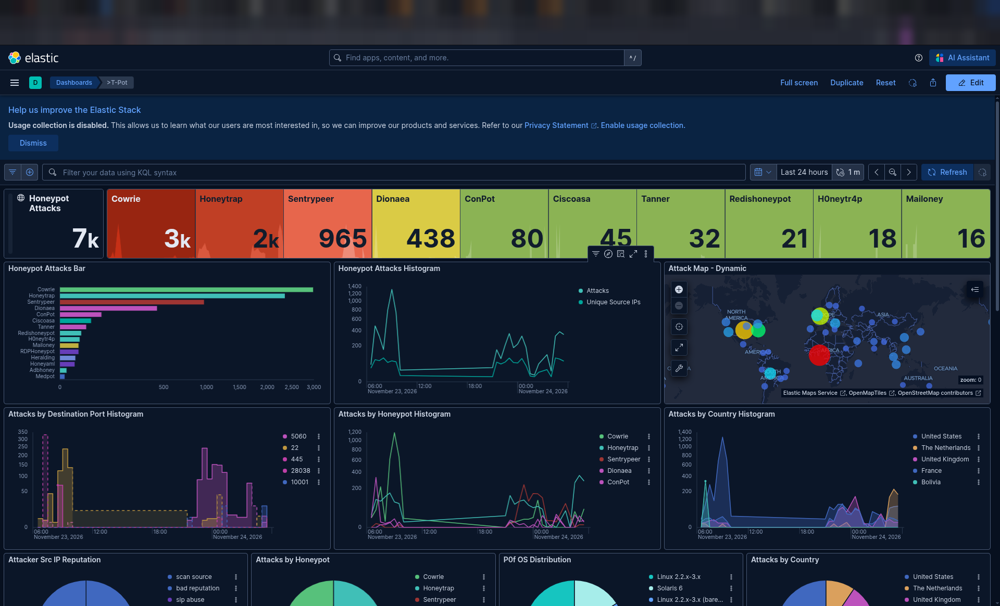
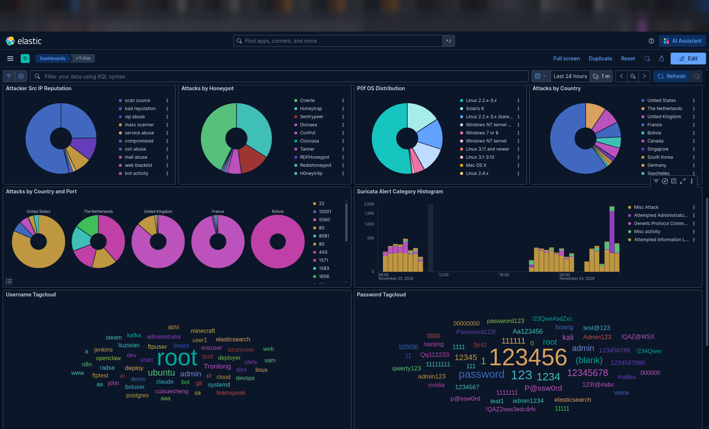
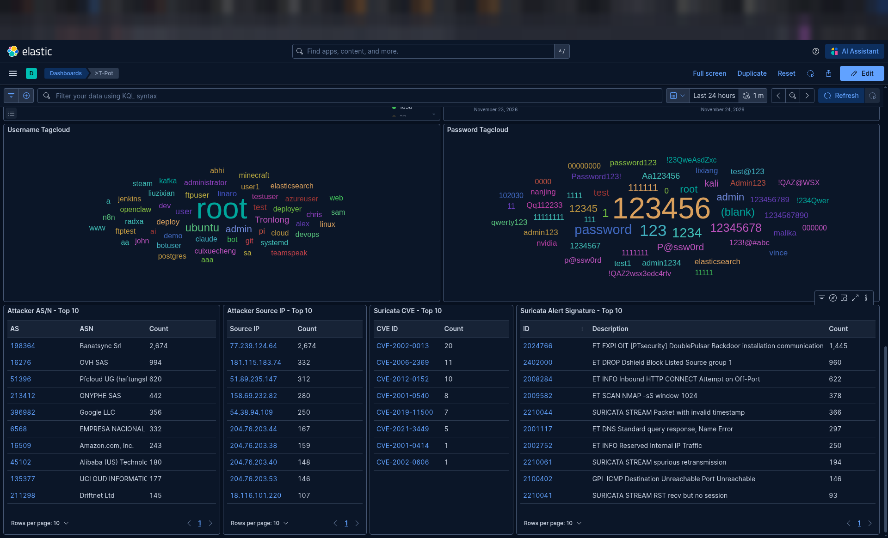

# 3. Attack analysis

[Back to README](../README.md)

## 3.1 Overview

About **7,000 attacks** were recorded in the 24 hour window. Cowrie (about 3,000) and Honeytrap (about 2,000) took most of them. Full counts are in [`data/honeypot_events.csv`](../data/honeypot_events.csv).

## 3.2 Timeline

| Time (Kibana) | What happened |
| --- | --- |
| About 07:30, 23 Nov | Largest spike, roughly 1,300 attacks in one interval, almost all from the United States (77.239.124.64) |
| About 10:00 to 21:30, 23 Nov | Almost no data and zero Suricata alerts. Treated as a collection gap |
| About 22:00, 23 Nov to 06:00, 24 Nov | Steady activity with peaks of 400 to 650 |
| About 05:30, 24 Nov | Suricata's biggest spike, close to 1,900 alerts, mostly Attempted Administrator Privilege Gain (DoublePulsar) |

The unique source IP line stayed low while attacks spiked, so a few sources made most of the noise.

## 3.3 Sources

### Matching IPs to networks

This analysis focuses on the three most active source IPs, matched to their networks:

| Source IP | Events | Network | Notes |
| --- | --- | --- | --- |
| 77.239.124.64 | 2,674 | AS198364 Banatsync Srl | All of this network's events came from this one IP |
| 181.115.183.74 | 332 | AS6568 Empresa Nacional de Telecomunicaciones | National telecom in Bolivia, likely a compromised device |
| 51.89.235.147 | 312 | AS16276 OVH SAS | Rented hosting server (OVH sent 994 events in total) |

These three account for 3,318 of the roughly 7,000 events. The top IP alone produced more than a third.

### Research scanners and clouds

ONYPHE SAS (442) and Driftnet Ltd (145) are internet scanning companies. Google, Amazon, Alibaba and UCLOUD are cloud providers where anyone can rent a machine. Their presence shows where attackers rent infrastructure, not that the companies are attacking.

### Countries

United States, the Netherlands, the United Kingdom, France, Bolivia, Canada, Singapore, South Korea, Germany and the Seychelles.

### Reputation tags

Most sources were tagged **scan source**, then **bad reputation**, **sip abuse**, **mass scanner**, **service abuse**, **compromised** and **ssh abuse**.

### Operating systems (P0f)

About half were guessed as Linux 2.2.x to 3.x, with smaller shares of Solaris, Windows NT, Windows 7 or 8 and Mac OS X. P0f is only an estimate.

## 3.4 Credentials

### Usernames by group

| Group | Examples |
| --- | --- |
| System defaults | root, admin, administrator, user, test, ubuntu |
| Service accounts | postgres, elasticsearch, kafka, jenkins, git, ftpuser, sa |
| Cloud and developer | azureuser, deploy, deployer, devops, dev, cloud |
| Small boards and IoT | pi, radxa, linaro, Tronlong |
| Game and chat servers | minecraft, steam, teamspeak |
| AI and automation tools | n8n, openclaw, claude, ai |

### Password patterns

| Pattern | Examples |
| --- | --- |
| Most common | 123456, password, 123, 1234, 12345678, blank |
| Number runs | 111111, 123456789, 1234567890, 00000000 |
| Keyboard walks | !QAZ2wsx3edc4rfv, !QAZ@WSX, !23QweAsdZxc |
| Weak "complex" | P@ssw0rd, Password123!, Admin123, qwerty123 |
| Same as username | root, admin, test, elasticsearch, nvidia, kali |

## 3.5 Ports

| Port | Service | Reason |
| --- | --- | --- |
| 5060 | SIP | Toll fraud |
| 22 | SSH | Remote shell |
| 445 | SMB | EternalBlue and WannaCry style attacks |
| 28038 | No standard service | Likely one scanner sweeping high ports |
| 10001 | Used by some industrial and network devices | Finding exposed equipment |

## 3.6 Suricata

Signatures: [`data/suricata_signatures.csv`](../data/suricata_signatures.csv)
CVEs: [`data/suricata_cves.csv`](../data/suricata_cves.csv)

* **DoublePulsar (SID 2024766, 1,445 alerts).** DoublePulsar is the backdoor implant used with the EternalBlue SMB exploit, both leaked in 2017 and used by WannaCry. Bots still spray it at every IP with port 445 open. Suricata counted 1,445 matching packets while Dionaea counted 438 SMB events, because one connection produces many packets.
* **DShield block list (960).** Traffic from IPs already on the DShield top attacker list.
* **HTTP CONNECT on an unusual port (622).** Bots checking whether the server is an open proxy.
* **Nmap SYN scans (378).** Classic port scanning.
* The `SURICATA STREAM` alerts are malformed or unexpected TCP packets, which are typical of fast scanning tools.

Alert categories: Misc Attack, Attempted Administrator Privilege Gain, Generic Protocol Command Decode, Misc Activity, Attempted Information Leak.
