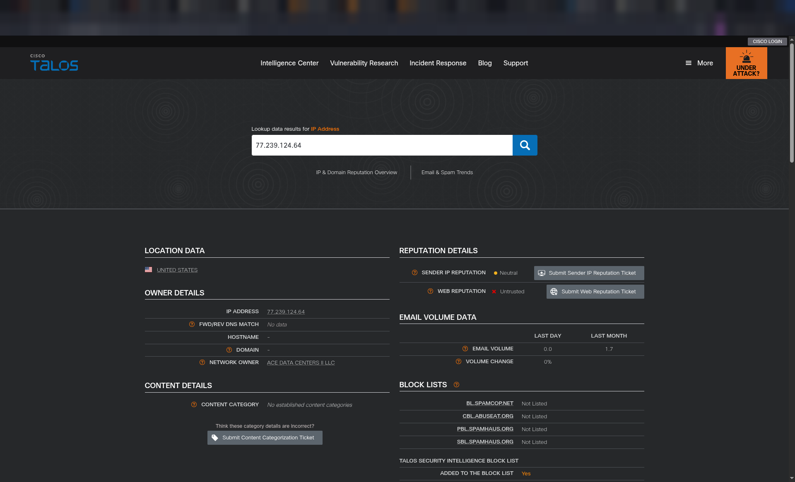
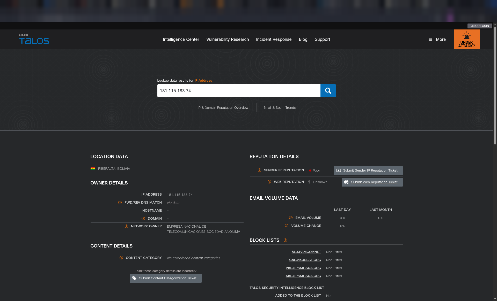
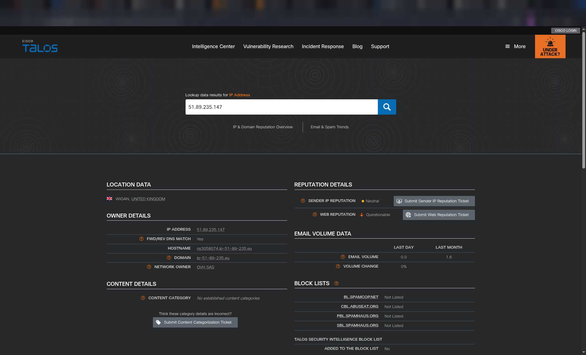
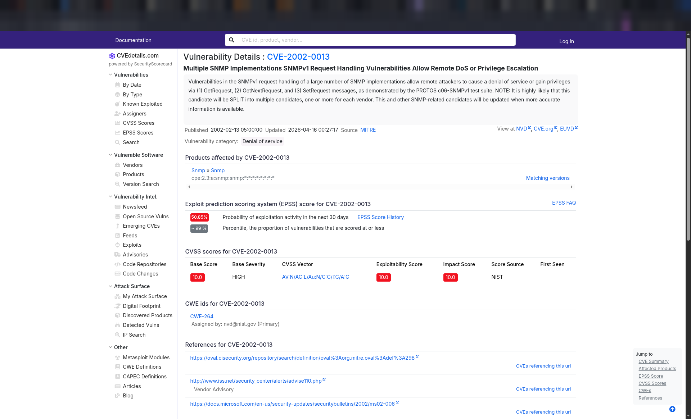

# 4. Threat intelligence enrichment

[Back to README](../README.md)

I took the three noisiest IPs and the most frequent CVE and checked them against outside sources.

## 4.1 Cisco Talos

| | 77.239.124.64 | 181.115.183.74 | 51.89.235.147 |
| --- | --- | --- | --- |
| Events on honeypot | 2,674 | 332 | 312 |
| Location | United States | Riberalta, Bolivia | Wigan, United Kingdom |
| Network owner | ACE Data Centers II LLC | Empresa Nacional de Telecomunicaciones SA | OVH SAS |
| Hostname | none | none | ns3058074.ip-51-89-235.eu |
| Forward and reverse DNS match | no data | no data | yes |
| Sender IP reputation | Neutral | Poor | Neutral |
| Web reputation | Untrusted | Unknown | Questionable |
| Email volume, last month | 1.7 | 0.0 | 1.6 |
| SpamCop, Abuseat, Spamhaus PBL and SBL | not listed | not listed | not listed |
| Talos Security Intelligence Block List | **Yes** | No | No |

### 77.239.124.64

The only one of the three on the Talos block list, with an Untrusted web reputation. It sent 2,674 events, more than a third of everything my honeypot saw. **Assessment:** known malicious infrastructure. Block.

### 181.115.183.74

Sits on Bolivia's national telecom provider with no hostname, which usually means a home or business line. A Poor sender reputation suggests the device is infected and used without its owner knowing. **Assessment:** probably a compromised device. Block, but expect the address to change.

### 51.89.235.147

A standard OVH dedicated server hostname with matching DNS. Not on any block list, but Questionable web reputation. **Assessment:** a rented server being used for scanning. Monitor.

### Disagreement between sources

Kibana's ASN lookup put 77.239.124.64 under AS198364 Banatsync Srl, while Talos names ACE Data Centers II LLC in the United States. IP ranges are leased and resold, and every database updates on a different schedule. This is why an analyst should never rely on a single source for ownership.

## 4.2 CVEdetails.com: CVE-2002-0013

| Field | Value |
| --- | --- |
| Title | Multiple SNMP implementations SNMPv1 request handling vulnerabilities allow remote DoS or privilege escalation |
| Published | 13 February 2002 |
| Category | Denial of service |
| CVSS base score | 10.0 High |
| Vector | AV:N/AC:L/Au:N/C:C/I:C/A:C |
| Exploitability and impact | 10.0 and 10.0 |
| EPSS | 50.85% probability of exploitation activity in the next 30 days, about the 99th percentile |
| CWE | CWE-264 |

**Reading the vector:** attack over the network (AV:N), low complexity (AC:L), no authentication (Au:N), complete loss of confidentiality, integrity and availability (C:C/I:C/A:C).

**Why it matters:** a 24 year old bug still sits near the top of EPSS because so many old routers, printers and embedded devices still answer SNMPv1. My honeypot saw 20 attempts against it in a single day.

## 4.3 Other CVEs

| CVE | Count | Short explanation |
| --- | --- | --- |
| CVE-2006-2369 | 11 | RealVNC 4.1.1 lets a client skip authentication |
| CVE-2012-0152 | 10 | Remote Desktop denial of service |
| CVE-2001-0540 | 8 | Windows NT and 2000 Terminal Services crash from malformed RDP |
| CVE-2019-11500 | 7 | Dovecot IMAP memory corruption |
| CVE-2021-3449 | 5 | OpenSSL server crash from a malicious renegotiation |
| CVE-2001-0414 | 1 | ntpd buffer overflow |
| CVE-2002-0606 | 1 | 3Com 3CDaemon FTP server buffer overflow ([NVD](https://nvd.nist.gov/vuln/detail/CVE-2002-0606)) |
