# Operation Honeycomb: 24 Hour T-Pot Threat Intelligence Report

**Author:** Usman Khalid Jibrin

**Project:** Threat Intelligence Report

**Environment:** T-Pot 24.04.1 honeypot on an AWS EC2 server (eu-north-1, Stockholm)

**Observation window:** 23 November 2026, 06:00 to 24 November 2026, 06:11 (about 24 hours)

**Date completed:** 24 November 2026

## At a glance

| Measure | Result |
| --- | --- |
| Observation window | About 24 hours (23 to 24 November 2026) |
| Total attacks recorded | About 7,000 |
| Busiest honeypot | Cowrie (SSH and Telnet), about 3,000 events |
| Noisiest attacker | 77.239.124.64, 2,674 events, on the Talos block list |
| Most tried login | username root, password 123456 |
| Top IDS alert | DoublePulsar backdoor, 1,445 alerts |
| Most seen vulnerability | CVE-2002-0013 (SNMP, CVSS 10.0) |
| Countries seen | 10 or more |

## 1. Executive summary

I wanted to find out what really happens to a computer the moment it is put online, so I set up a trap and watched. The trap is called a honeypot: a server that looks ordinary but has no real job except to be attacked. Because nobody has an honest reason to connect to it, I can treat every single visitor as suspicious. I left mine running on the internet for about a day and recorded everything that reached it.

The honeypot software I used is called T-Pot, and I ran it on a rented Amazon cloud server. I deliberately left almost all of its network doors (its ports) open so attackers could reach it. Behind those doors sat fake copies of the services attackers usually hunt for, such as a remote login, a file share and an internet phone system, and each one quietly logged whoever tried to break in. At the same time a separate tool inspected the traffic for known attack patterns, and a set of dashboards turned all those events into charts I could read. Finally, I looked up the busiest attackers and the weaknesses they tried on two public security websites.

In that single day the honeypot was attacked about 7,000 times by machines in at least ten countries. A few things really stood out to me:

- **Password guessing on SSH was by far the most common attack.** SSH is the tool administrators use to control a Linux server from somewhere else, so it is a real prize. Automated programs tried obvious logins over and over, and the clear favourite was the username `root` with the password `123456`.
- **One attacker did most of the work.** A single address, 77.239.124.64, was behind more than a third of everything I saw, and a well known security service already lists it as dangerous.
- **Attackers are still firing very old weapons.** The most frequent warning was for an attack called DoublePulsar from 2017, and the weakness they probed most often dates all the way back to 2002.
- **They did not only go after servers.** Internet phone systems, and even industrial equipment, were poked at too.

The lesson is blunt: anything you connect to the internet is found and attacked within minutes, almost entirely by automated programs trying weak passwords and old, unpatched flaws. None of it was clever, and that is really the point. Simple habits would have blocked nearly everything I recorded: using strong passwords, or better still login keys instead of passwords, keeping software up to date, and closing any doors you are not using.

## Contents

1. Executive summary
2. Objective
3. Prerequisites
4. Skills learned
5. Tools used
6. Architecture plan
7. Deployment steps
8. Methodology
9. Investigation
10. Q1. Who are the attackers?
11. Q2. What are the common attacks?
12. MITRE ATT&CK mapping and indicators
13. Limitations, recommendations and conclusion

- Sources

## 2. Objective

The aim of this project was to see real attacker behaviour for myself instead of reading about it, and to practise the full threat intelligence process from raw logs to written conclusions.

My objectives were to:

1. Deploy a multi honeypot platform (T-Pot) on a public cloud server and expose it safely to the internet.
2. Collect attack data for a fixed window of about 24 hours.
3. Use Kibana to work out who attacked, from where, which services they targeted and what they tried.
4. Enrich the most important indicators with outside threat intelligence (Cisco Talos and CVEdetails.com).
5. Map the behaviour to the MITRE ATT&CK framework and recommend defences.

**In scope:** the single T-Pot server, its honeypot containers, Suricata alerts and the Kibana dashboards for the last 24 hours.

**Out of scope:** attributing attacks to named threat groups, interacting with or attacking any source IP, and analysing malware samples. A honeypot only shows where traffic came from, not who was really behind the keyboard, so I have kept observation and attribution separate throughout.

## 3. Prerequisites

Before starting I needed the following:

- An AWS account with permission to launch EC2 instances and edit security groups
- An EC2 instance large enough for T-Pot's full install, since it runs many Docker containers plus the ELK stack
- A key pair for SSH access
- A Kali Linux machine with an SSH client and a web browser
- Basic Linux command line skills (SSH, git, editing files, rebooting)
- An understanding of TCP and UDP ports and how a firewall rule works
- Free accounts or public access to Cisco Talos Intelligence and CVEdetails.com for enrichment

## 4. Skills learned

| Skill | How this project built it |
| --- | --- |
| Cloud deployment | Launching and securing an EC2 instance and writing security group rules |
| Honeypot operations | Installing T-Pot, understanding what each honeypot emulates, and keeping management access separate |
| SIEM and log analysis | Reading the Elastic stack dashboards in Kibana and filtering by time |
| Network protocols | Recognising what attackers want from SSH, SIP, SMB, SNMP, RDP and VNC |
| Intrusion detection | Interpreting Suricata signatures, alert categories and CVE matches |
| Threat intelligence | Enriching IPs and CVEs with Cisco Talos and CVEdetails.com, and comparing sources |
| Vulnerability scoring | Reading CVSS vectors, EPSS scores and CWE categories |
| Attacker behaviour mapping | Mapping activity to MITRE ATT&CK techniques |
| Analytical thinking | Correlating tables, spotting data gaps and separating observation from attribution |
| Incident response thinking | Turning findings into indicators of compromise and defensive recommendations |

## 5. Tools used

| Tool | Purpose |
| --- | --- |
| AWS EC2 | Cloud server hosting the honeypot |
| T-Pot 24.04.1 | Multi honeypot platform running in Docker |
| Suricata | Network intrusion detection and CVE matching |
| P0f | Passive operating system fingerprinting |
| Elastic stack (Elasticsearch, Logstash, Kibana) | Log collection, storage, SIEM dashboards |
| Kali Linux | Admin workstation for SSH and browser access |
| Cisco Talos Intelligence | IP reputation, owner and block list checks |
| CVEdetails.com | CVSS, EPSS and CWE details for CVEs |
| MITRE ATT&CK | Framework for describing attacker techniques |

## 6. Architecture plan

The lab has three parts: the attackers on the internet, one EC2 server running T-Pot inside Docker, and my Kali Linux machine, which I used to manage the server and read the dashboards. The architecture graphic gives the full picture with the attack counts, and the simpler diagram after it shows how the parts connect.

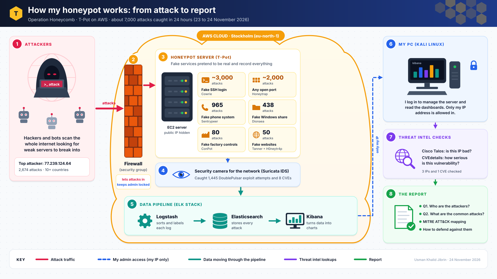

*Figure A. How my honeypot works. (1) Attackers and bots scan the internet. (2) The AWS firewall lets attack traffic in but keeps admin access locked to my IP. (3) T-Pot's fake services record every attempt. (4) Suricata watches the traffic like a security camera. (5) The ELK pipeline sorts, stores and charts the data. (6) I read the dashboards from my Kali PC. (7) I check the top IPs and CVEs with threat intelligence. (8) I write the report.*

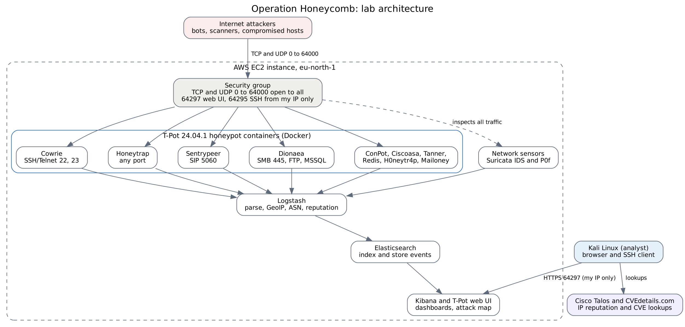

Attack traffic enters through the wide open honeypot ports, while the web UI and real SSH are only reachable from my Kali machine.

### 6.1 Components

| Layer | Component | What it does in this project |
| --- | --- | --- |
| Cloud | AWS EC2, region eu-north-1 | Hosts the honeypot on a public IP address (hidden in this report) |
| Network | AWS security group | Lets attack traffic reach the honeypots and limits who can manage the server |
| Honeypots | Cowrie, Honeytrap, Sentrypeer, Dionaea, ConPot, Ciscoasa, Tanner, Redishoneypot, H0neytr4p, Mailoney and others | Pretend to be real services (SSH, SIP, SMB, web, Redis, email, industrial systems) and log everything sent to them |
| Network sensors | Suricata IDS, P0f | Suricata matches traffic against known attack signatures and CVEs. P0f guesses the attacker's operating system passively |
| Data pipeline | Logstash | Reads every log, adds country, ASN and IP reputation, then sends it on |
| Storage | Elasticsearch | Stores and indexes all events so they can be searched quickly |
| Visualisation | Kibana and the T-Pot web UI | Dashboards, attack map, CyberChef, Elasticvue and Spiderfoot, reached over HTTPS on port 64297 |
| Management | Kali Linux over SSH on port 64295 | My admin access to the server, allowed only from my own IP address |
| Enrichment | Cisco Talos Intelligence, CVEdetails.com | Outside sources I used to check reputation and vulnerability details |

### 6.2 How the reports were made

Every figure in this report came through the same pipeline, shown in the diagram below:

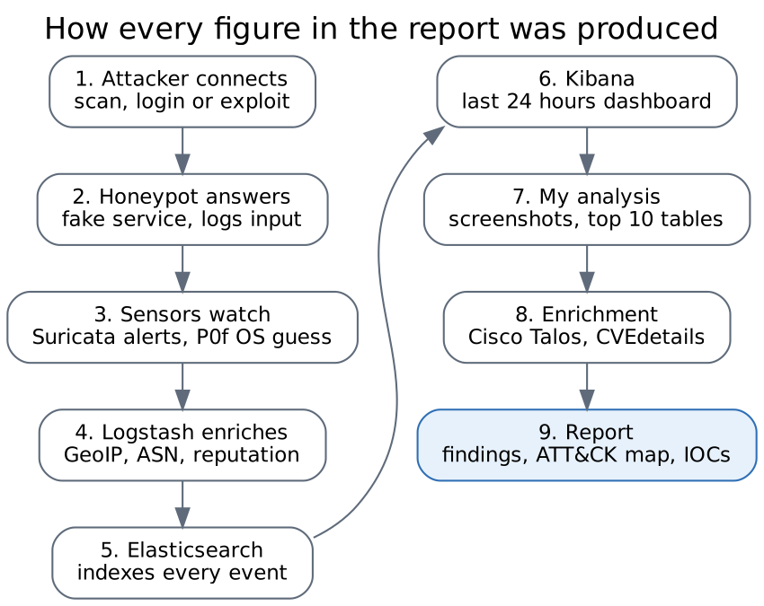

1. **Capture.** Each honeypot logs the attempts against it, while Suricata and P0f watch the traffic.
2. **Enrich.** Logstash adds each source's country, network and reputation.
3. **Store and chart.** Elasticsearch indexes every event, and Kibana turns it into the dashboards in this report (set to the last 24 hours).
4. **Analyse.** I read the dashboards, captured the screenshots, and looked up the top IPs and CVE on Cisco Talos and CVEdetails.

## 7. Deployment steps

I deployed the honeypot in three steps: launch and secure the server, install T-Pot, then check that everything was running.

### Step 1: Launch an AWS EC2 instance

1. I signed in to the AWS console, opened the EC2 dashboard and switched to the eu-north-1 (Stockholm) region.
2. I launched an instance with a Linux image supported by T-Pot and chose an instance size with enough memory and storage for the full install.
3. I created a key pair so I could log in over SSH from Kali.
4. I started with SSH allowed only from my own IP, then changed the security group to the rules below once T-Pot was installed.

#### Security group rules

| Rule | Protocol | Port range | Source | Purpose |
| --- | --- | --- | --- | --- |
| Custom TCP | TCP | 64297 | 0.0.0.0/0 | T-Pot web UI and Kibana (password protected) |
| Custom TCP | TCP | 0 to 64000 | 0.0.0.0/0 | Honeypot services on TCP |
| Custom UDP | UDP | 0 to 64000 | 0.0.0.0/0 | Honeypot services on UDP (SIP, SNMP and others) |
| SSH | TCP | 22 | 0.0.0.0/0 | Cowrie SSH honeypot (the real SSH is moved by T-Pot) |
| Custom TCP | TCP | 64295 | My IP only (/32) | Real SSH for administration from Kali |

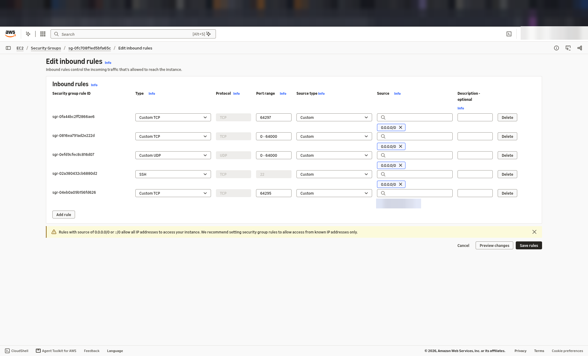

*Figure 1. AWS security group inbound rules for the honeypot instance (account details redacted).*

Three points about this configuration are worth noting:

- **The honeypot range is wide on purpose.** Opening TCP and UDP 0 to 64000 to everyone gives attackers the biggest possible target, which is what a research honeypot needs.
- **Management is locked down.** T-Pot moves the real SSH service to port 64295, and I only allowed that port from my own IP address. Port 22 is Cowrie, not a real login.
- **One thing I would change.** The web UI on 64297 was open to 0.0.0.0/0. It is protected by a username and password, but AWS warns about this and I would restrict it to my own IP next time. The separate port 22 rule is also redundant because 0 to 64000 already covers it.

### Step 2: Install T-Pot on EC2

1. I connected from Kali with `ssh -i key.pem user@<public-ip>` and updated the system packages.
2. I installed git, then cloned the official T-Pot repository from Deutsche Telekom Security.
3. I ran the T-Pot installer, chose the standard installation and set a web username and password.
4. When the installer finished I rebooted the server. After the reboot T-Pot moved the real SSH service to port 64295, so from then on I connected with `ssh -i key.pem -p 64295 user@<public-ip>`.

### Step 3: Verify T-Pot is running

I logged back in on port 64295 and checked that the honeypot containers were running in Docker. I then opened `https://<public-ip>:64297` in my browser and signed in with the web credentials. The landing page confirmed version 24.04.1 and gave access to the Attack Map, CyberChef, Elasticvue, Kibana and Spiderfoot. The browser shows "Not secure" because T-Pot uses a self signed certificate, which is expected.

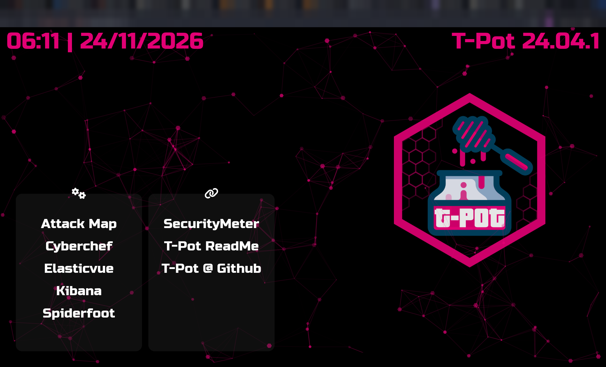

*Figure 2. T-Pot 24.04.1 landing page at 06:11 on 24 November 2026, the end of the observation window.*

## 8. Methodology

I followed the standard threat intelligence cycle: plan, collect, process, analyse, then report.

1. **Plan.** Run for about 24 hours, focusing on who attacked, from where, which services and how.
2. **Collect.** T-Pot gathered everything automatically; I never interacted with an attacker.
3. **Process.** In Kibana I set every chart to the last 24 hours.
4. **Analyse.** I worked through each dashboard panel, from honeypot totals to the Suricata tables.
5. **Enrich.** I checked the top three IPs on Cisco Talos and the top CVE on CVEdetails.
6. **Map and report.** I matched the behaviour to MITRE ATT&CK and wrote up the findings, separating fact from inference.

## 9. Investigation

After about 24 hours online the honeypot had recorded roughly 7,000 attacks. I analysed the data in the Elastic stack (Kibana) to answer the two investigation questions:

- **Q1. Who are the attackers?** (section 10)
- **Q2. What are the common attacks?** (section 11)

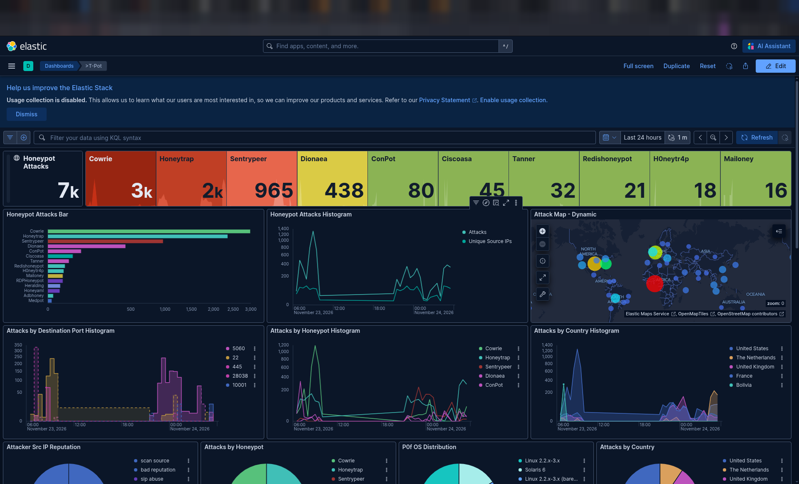

*Figure 3. T-Pot Kibana dashboard: honeypot totals, histograms and the dynamic attack map for the last 24 hours.*

### 9.1 Attack timeline

Activity came in bursts rather than a steady stream:

- **About 07:30 on 23 November:** the biggest spike, with roughly 1,300 attacks in a single interval. The country histogram shows this came almost entirely from the United States, which matches the single noisy IP 77.239.124.64 discussed in section 10.
- **About 10:00 to 21:30 on 23 November:** a much quieter window, with little activity and few Suricata alerts. Attack traffic comes in bursts rather than a steady stream, so this lull simply means the day's total is best read as a conservative figure.
- **About 22:00 on 23 November to 06:00 on 24 November:** steady activity with repeated peaks of 400 to 650 attacks.
- **About 05:30 on 24 November:** Suricata's largest spike, close to 1,900 alerts, mostly in the "Attempted Administrator Privilege Gain" category. This lines up with the DoublePulsar alerts in section 11.5.

The "Unique Source IPs" line stays low the whole time while the attack line spikes. That tells me a small number of IPs were responsible for a large share of the traffic.

## 10. Q1. Who are the attackers?

**Answer:** The attackers were mostly automated scanners and bots running on rented cloud and hosting servers, plus some compromised home or business devices. The top three attacking IPs were:

| Rank | IP address | Events | Location (Cisco Talos) | Owner (Cisco Talos) | Verdict |
| --- | --- | --- | --- | --- | --- |
| 1 | 77.239.124.64 | 2,674 | United States | ACE Data Centers II LLC | Known bad: on the Talos block list, web reputation Untrusted |
| 2 | 181.115.183.74 | 332 | Riberalta, Bolivia | Empresa Nacional de Telecomunicaciones SA | Probably a compromised device, sender reputation Poor |
| 3 | 51.89.235.147 | 312 | Wigan, United Kingdom | OVH SAS | Rented server, web reputation Questionable |

The top IP alone produced over a third of all events. Traffic came from at least 10 countries, led by the US, Netherlands, UK, France and Bolivia, and most sources were tagged as scanners or bad-reputation hosts (a few, such as ONYPHE and Driftnet, are legitimate research scanners). An IP shows where traffic came from, not who sent it, so I call these sources rather than name any attacker.

The evidence behind this answer follows.

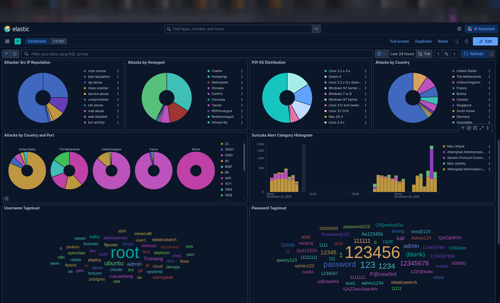

*Figure 4. Attacker reputation, attacks by honeypot, P0f operating systems, attacks by country and port, and the Suricata alert histogram.*

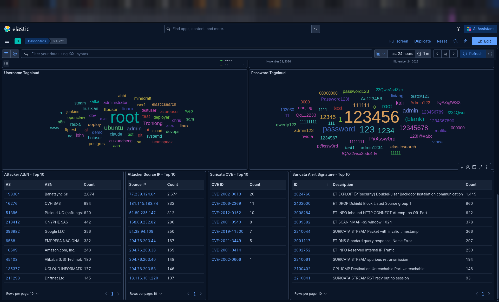

*Figure 5. Username and password tag clouds with the top 10 ASNs, source IPs, Suricata CVEs and alert signatures.*

### 10.1 Top three source IPs

| Rank | Source IP | Events | Network (from the ASN table) |
| --- | --- | --- | --- |
| 1 | 77.239.124.64 | 2,674 | AS198364 Banatsync Srl |
| 2 | 181.115.183.74 | 332 | AS6568 Empresa Nacional de Telecomunicaciones (Bolivia) |
| 3 | 51.89.235.147 | 312 | AS16276 OVH SAS |

I focused on the three most active source IPs and checked each one against the network (ASN) data. The links are clear:

- **77.239.124.64 (2,674 events)** maps to AS198364 Banatsync Srl, whose total was also 2,674, so every event from that network came from this one IP. It is the single noisiest attacker by a wide margin.
- **181.115.183.74 (332 events)** maps to AS6568 Empresa Nacional de Telecomunicaciones, a national telecom provider in Bolivia, which usually means a home or business line rather than a server.
- **51.89.235.147 (312 events)** is a rented server on AS16276 OVH SAS, a hosting provider. OVH as a whole sent 994 events across several addresses.

These three alone account for 3,318 of the roughly 7,000 events. I chose them as the focus for enrichment because they were the most active and together they cover the three types of source worth understanding: known bad infrastructure, a probably compromised device, and a rented server.

### 10.2 Top networks (ASNs)

| ASN | Organisation | Events |
| --- | --- | --- |
| 198364 | Banatsync Srl | 2,674 |
| 16276 | OVH SAS | 994 |
| 51396 | Pfcloud UG | 620 |
| 213412 | ONYPHE SAS | 442 |
| 396982 | Google LLC | 356 |
| 6568 | Empresa Nacional de Telecomunicaciones | 332 |
| 16509 | Amazon.com, Inc. | 243 |
| 45102 | Alibaba (US) Technology | 180 |
| 135377 | UCLOUD Information Technology | 177 |
| 211298 | Driftnet Ltd | 145 |

Not every source is malicious. ONYPHE and Driftnet are internet scanning companies that map exposed services for research and search engines. Google, Amazon and Alibaba are large clouds where anyone can rent a server, so their presence says more about where attackers rent infrastructure than about the companies themselves.

### 10.3 Countries, reputation and operating systems

- **Countries:** the top ten were the United States, the Netherlands, the United Kingdom, France, Bolivia, Canada, Singapore, South Korea, Germany and the Seychelles. The United States led mainly because of 77.239.124.64.
- **IP reputation:** T-Pot's reputation tags put most sources in the "scan source" group, followed by "bad reputation", "sip abuse", "mass scanner", "service abuse", "compromised" and "ssh abuse". The "compromised" tag is a reminder that some attacks come from hacked machines being used as stepping stones.
- **Operating systems:** P0f guessed about half the attacking systems were Linux 2.2.x to 3.x, with smaller shares of Solaris, Windows NT, Windows 7 or 8 and Mac OS X. This fits automated tools running on Linux servers. P0f is only a guess from TCP behaviour, so I treat this as a rough picture rather than fact.

### 10.4 Cisco Talos IP reputation

Only one of the three noisiest IPs, 77.239.124.64, was on the Talos block list, which shows that a clean block list result does not mean an IP is safe.

|  | 77.239.124.64 | 181.115.183.74 | 51.89.235.147 |
| --- | --- | --- | --- |
| Events on my honeypot | 2,674 | 332 | 312 |
| Location (Talos) | United States | Riberalta, Bolivia | Wigan, United Kingdom |
| Network owner (Talos) | ACE Data Centers II LLC | Empresa Nacional de Telecomunicaciones SA | OVH SAS |
| Hostname | None | None | ns3058074.ip-51-89-235.eu |
| Forward and reverse DNS match | No data | No data | Yes |
| Sender IP reputation | Neutral | Poor | Neutral |
| Web reputation | Untrusted | Unknown | Questionable |
| Talos Security Intelligence Block List | **Yes** | No | No |
| SpamCop, Abuseat, Spamhaus PBL and SBL | Not listed | Not listed | Not listed |

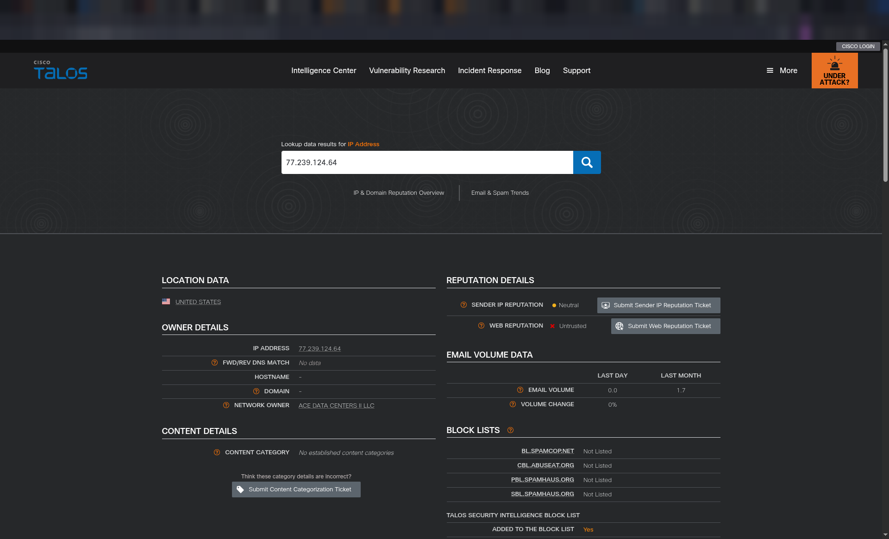

*Figure 6. Cisco Talos lookup for 77.239.124.64.*

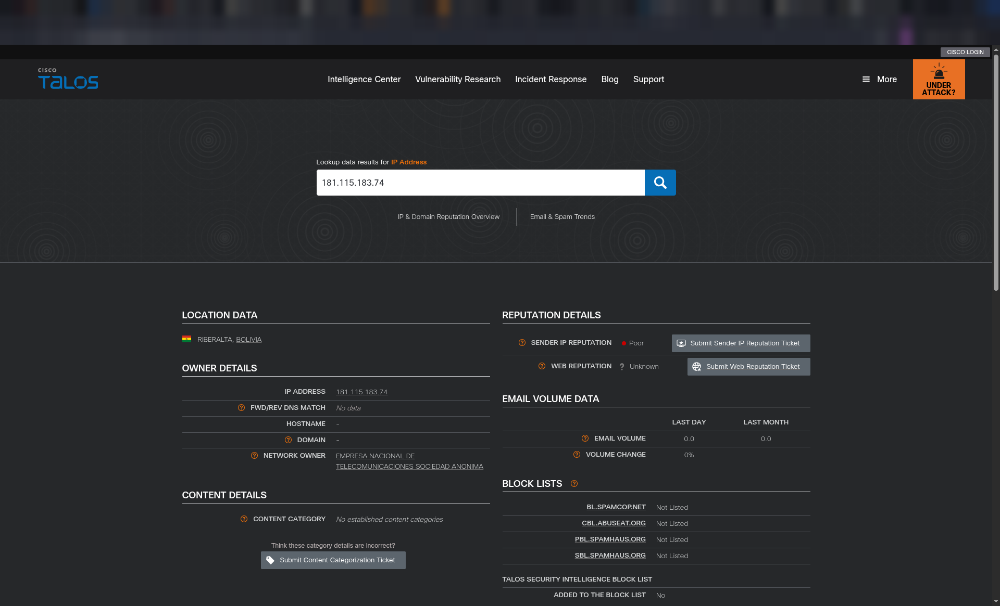

*Figure 7. Cisco Talos lookup for 181.115.183.74.*

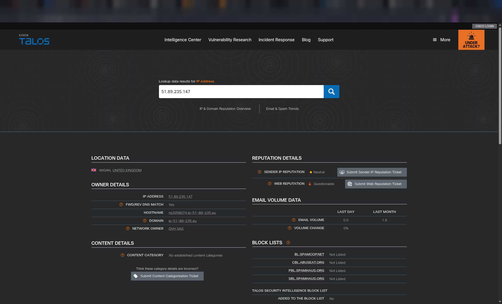

*Figure 8. Cisco Talos lookup for 51.89.235.147.*

What I took from these lookups:

- **77.239.124.64: known bad.** The only one on the Talos block list, with an Untrusted web reputation, matching its 2,674 events.
- **181.115.183.74: probably compromised.** On a Bolivian telecom (so likely a home or business line, not a server), with a Poor sender reputation, a sign the device is infected.
- **51.89.235.147: a rented server.** A normal OVH hostname with matching DNS, so a dedicated server being used for scanning.
- **The sources disagree on ownership.** Kibana puts the top IP under Banatsync Srl, Talos under ACE Data Centers II LLC, a reminder that one source is never enough.

## 11. Q2. What are the common attacks?

**Answer:** The most common attacks were:

1. **SSH brute force.** Cowrie received about 3,000 events. `root` was the most tried username and `123456` the most tried password.
2. **Port scanning.** Honeytrap caught about 2,000 connections to random ports, and Suricata flagged 378 Nmap SYN scans.
3. **VoIP (SIP) abuse.** Sentrypeer logged 965 attempts on port 5060, usually aimed at toll fraud.
4. **SMB exploitation.** The most frequent Suricata alert was DoublePulsar backdoor communication (1,445 alerts), the tool used with EternalBlue and WannaCry.
5. **Old vulnerability exploits.** Suricata matched 8 CVEs. The most common was CVE-2002-0013 (SNMPv1, 20 attempts), followed by CVE-2006-2369 (RealVNC authentication bypass, 11) and CVE-2012-0152 (Remote Desktop denial of service, 10).
6. **Open proxy testing.** 622 HTTP CONNECT attempts checked whether the server could be used to relay traffic.

The evidence behind this answer follows.

### 11.1 Attacks per honeypot

| Honeypot | Events | What it emulates | Main ports |
| --- | --- | --- | --- |
| Cowrie | about 3,000 | SSH and Telnet server | 22, 23 |
| Honeytrap | about 2,000 | Catches connections to any port without a dedicated honeypot | Any |
| Sentrypeer | 965 | SIP (VoIP phone) server | 5060 |
| Dionaea | 438 | Windows services such as SMB, FTP and MSSQL | 445, 21, 1433 |
| ConPot | 80 | Industrial control systems (Modbus, S7 and similar) | 102, 502 and others |
| Ciscoasa | 45 | Cisco ASA firewall VPN portal | 8443, 5000 UDP |
| Tanner | 32 | Web application | 80 |
| Redishoneypot | 21 | Redis database | 6379 |
| H0neytr4p | 18 | Web server | 80, 443 |
| Mailoney | 16 | SMTP mail server | 25 |

Smaller counts also appeared on RDPHoneypot, Heralding, Honeyaml, Adbhoney and Medpot. Totals for Cowrie and Honeytrap are rounded by Kibana.

This split makes sense: SSH gives full control of a Linux machine if a login works, Honeytrap is high because scanners touch thousands of random ports, and Sentrypeer's 965 events reflect how often VoIP servers are hit for toll fraud.

### 11.2 Usernames

`root` was by far the most tried username, followed by `ubuntu`, `admin`, `user`, `test` and `deploy`. Grouping the rest shows what the bots were hoping to find:

| Group | Examples from the tag cloud | What the attacker hopes for |
| --- | --- | --- |
| System defaults | root, admin, administrator, user, test, ubuntu | Full control of a freshly built server |
| Service accounts | postgres, elasticsearch, kafka, jenkins, git, ftpuser, sa | A database or build server installed with its default account |
| Cloud and developer accounts | azureuser, deploy, deployer, devops, dev, cloud | Default users created by cloud images and deployment scripts |
| Small boards and IoT | pi, radxa, linaro, Tronlong | Raspberry Pi and similar boards that ship with known logins |
| Game and chat servers | minecraft, steam, teamspeak | Hobby servers that are often poorly secured |
| AI and automation tools | n8n, openclaw, claude, ai | Newly popular self hosted AI and workflow tools |

The last group surprised me. It shows that attackers update their wordlists quickly to follow whatever software people are currently installing.

### 11.3 Passwords

`123456` was the most common password by a wide margin, followed by `password`, `123`, `1234`, `12345678`, a blank password, `admin`, `12345`, `root` and `P@ssw0rd`. Other patterns included:

- **Number runs:** 111111, 1234567890, 123456789, 00000000
- **Keyboard walks:** !QAZ2wsx3edc4rfv, !QAZ@WSX, !23QweAsdZxc
- **Weak "complex" passwords:** Password123!, Admin123, admin123, qwerty123, P@ssw0rd
- **Username as password:** root, admin, test, elasticsearch, nvidia, kali

Passwords like `P@ssw0rd` and `Password123!` pass many basic complexity rules but are still in every attacker's list. Complexity rules alone do not make a password safe.

### 11.4 Targeted ports

The five busiest destination ports were:

| Port | Service | Why attackers want it |
| --- | --- | --- |
| 5060 | SIP (VoIP) | Hijack phone systems to make paid calls (toll fraud) |
| 22 | SSH | Remote shell access to Linux servers |
| 445 | SMB | Windows file sharing, the target of EternalBlue and WannaCry |
| 28038 | No standard service | Probably one scanner sweeping high ports |
| 10001 | Used by some industrial devices and network gear | Finding exposed equipment |

The country and port panel showed each country focusing on a small set of ports. Bolivia's traffic, for example, went almost entirely to one port, which fits a single source (181.115.183.74) running one task over and over.

### 11.5 Suricata alerts and CVEs

Suricata's top alert was DoublePulsar backdoor traffic (1,445 alerts), and the CVEs it matched were mostly old flaws from 2001 to 2012 that bots still try in case an unpatched device answers.

The alert categories in the histogram were Misc Attack, Attempted Administrator Privilege Gain, Generic Protocol Command Decode, Misc Activity and Attempted Information Leak.

#### Top alert signatures

| Signature ID | Signature | Count | What it means |
| --- | --- | --- | --- |
| 2024766 | `ET EXPLOIT [PTsecurity] DoublePulsar Backdoor installation communication` | 1,445 | Attempts to plant or talk to the DoublePulsar SMB backdoor, the implant used with EternalBlue and WannaCry in 2017 |
| 2402000 | `ET DROP Dshield Block Listed Source group 1` | 960 | Traffic from IPs already on the DShield list of top attackers |

*Only the two most frequent signatures are shown; the full list of ten is in the repository (`data/suricata_signatures.csv`).*

DoublePulsar had 1,445 alerts while Dionaea, the SMB honeypot, logged 438 events. The numbers differ because Suricata counts every matching packet, while Dionaea counts connections. Because Dionaea only emulates SMB, none of these attempts could actually install anything.

#### CVEs matched by Suricata

| CVE | Count | Affected software | Impact |
| --- | --- | --- | --- |
| CVE-2002-0013 | 20 | SNMPv1 in many vendors' devices | Denial of service or privilege escalation |
| CVE-2006-2369 | 11 | RealVNC 4.1.1 | Authentication bypass, remote desktop without a password |

*Only the two most frequent CVEs are shown; all eight are in the repository (`data/suricata_cves.csv`).*

The SNMP, RDP and VNC CVEs fit the ports that were probed and the honeypots that responded (ConPot answers SNMP, and RDPHoneypot answers RDP). Seeing exploits from 2001 and 2002 in 2026 shows that attackers fire everything they have at every IP, because forgotten old devices are still online.

### 11.6 CVEdetails.com lookup for CVE-2002-0013

I looked up the most frequent CVE in more detail.

| Field | Value |
| --- | --- |
| Title | Multiple SNMP implementations SNMPv1 request handling vulnerabilities |
| Published | 13 February 2002 |
| Category | Denial of service |
| CVSS base score | 10.0 (High) |
| CVSS vector | AV:N/AC:L/Au:N/C:C/I:C/A:C |
| EPSS | 50.85% chance of exploitation activity in the next 30 days (about the 99th percentile) |
| CWE | CWE-264 (permissions, privileges and access controls) |

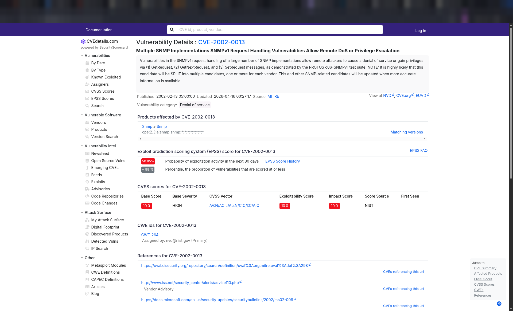

*Figure 9. CVEdetails.com entry for CVE-2002-0013.*

The vector means the flaw is attackable over the network, needs no login, and can fully compromise a system. The striking part is the EPSS score: despite being 24 years old, this bug still ranks above about 99% of all CVEs for likely exploitation, which my 20 attempts in a day bear out.

### 11.7 Attack simulation: testing with Hydra

To see an SSH brute force from the attacker's side, I ran a controlled test with Hydra from my Kali machine against my own AWS server. I only tested a system I own and control; I did not test any machine belonging to anyone else.

The command used the username `root` and a wordlist against the SSH service:

```
hydra -l root -P /usr/share/wordlists/rockyou.txt -t 4 -f ssh://<my-server>
```

Hydra found a weak password within seconds, and I then used it to open an SSH session. This confirmed first hand what the honeypot data already showed: a weak or default password gives an attacker a full command line on the server. The screenshot below has the server's IP address and the cracked password blurred for safety.

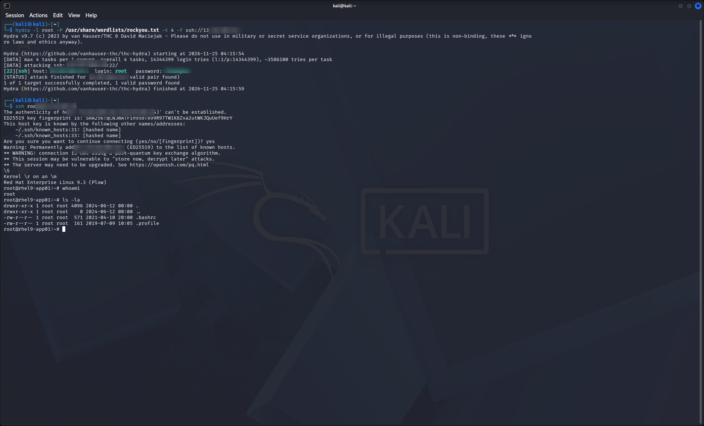

*Figure 10. A controlled Hydra brute force against my own AWS server, run from Kali Linux. The target IP and the recovered password are redacted.*

This is a real login to my own server, so it shows the risk of weak credentials rather than the honeypot catching an attack. It lines up with section 11, where the honeypot recorded thousands of real SSH attempts using `root` and `123456`. The difference is that the recommendations in section 13, such as disabling password logins and using SSH keys, would stop exactly this kind of attack.

## 12. MITRE ATT&CK mapping and indicators

Everything I observed sits in the earliest stages of an attack: reconnaissance, initial access attempts and credential attacks. Because these were honeypots, no attacker got past that point.

### 12.1 MITRE ATT&CK mapping

| Tactic | Technique | ID | Evidence from my data |
| --- | --- | --- | --- |
| Reconnaissance | Active Scanning: Scanning IP Blocks | T1595.001 | Honeytrap events across thousands of ports, Nmap SYN scan alerts |
| Reconnaissance | Active Scanning: Vulnerability Scanning | T1595.002 | Suricata CVE matches for SNMP, RDP, VNC, OpenSSL and Dovecot |
| Discovery | Network Service Discovery | T1046 | Repeated probing of 5060, 22, 445 and 10001 |
| Credential Access | Brute Force: Password Guessing | T1110.001 | Cowrie logins with root, admin and 123456 |
| Credential Access | Brute Force: Password Spraying | T1110.003 | The same short password list tried across many usernames |
| Initial Access | Valid Accounts: Default Accounts | T1078.001 | Attempts with pi, postgres, elasticsearch, azureuser and similar defaults |
| Initial Access | Exploit Public Facing Application | T1190 | Exploit attempts against SNMP, VNC, mail and FTP services |
| Lateral Movement | Exploitation of Remote Services | T1210 | DoublePulsar and SMB exploit traffic on port 445 |
| Command and Control | Proxy | T1090 | HTTP CONNECT attempts testing for an open proxy |
| Impact | Endpoint Denial of Service | T1499 | DoS CVEs such as CVE-2012-0152 and CVE-2001-0540 |

T1210 is normally a lateral movement technique inside a network. I included it because DoublePulsar and EternalBlue are worm tools built to spread from machine to machine, and here they were aimed straight at an internet facing host.

### 12.2 Indicators of compromise

These indicators could be added to a firewall block list or a SIEM watch list. They are observations from one honeypot over one day, so they should be reviewed before blocking.

| Indicator | Type | Evidence | Suggested action |
| --- | --- | --- | --- |
| 77.239.124.64 | IPv4 | 2,674 events, Talos block listed, web reputation Untrusted | Block |
| 181.115.183.74 | IPv4 | 332 events, Talos sender reputation Poor | Block |
| 51.89.235.147 | IPv4 | 312 events, web reputation Questionable | Monitor |
| Suricata SID 2024766 | Signature | DoublePulsar, 1,445 alerts | Alert on any match in a real network |
| root / 123456 | Credential pair | Most tried username and password | Make sure no real system uses them |

## 13. Limitations, recommendations and conclusion

### 13.1 Limitations

- **Time window.** This study covers a 24-hour window. That is enough to capture a large, clear sample of automated attacks, though a longer run would also surface slower, more targeted activity.
- **Single vantage point.** The honeypot ran from one AWS region (Stockholm), so the mix of countries and services reflects what is visible from there.
- **Observation, not attribution.** An IP address shows where traffic came from, not who was behind it, so throughout the report I treat sources as observations rather than naming attackers.
- **Automated activity.** A honeypot mainly draws automated scanners and bots, so the findings represent opportunistic, internet-wide attacks rather than a single targeted intrusion.
- **Reading the figures.** All figures come from the live Kibana dashboards, which are built directly from the captured data. A few summary tiles display large totals rounded (for example "3k"), so where an exact number matters I take it from the top-ten tables.

### 13.2 Recommendations

These recommendations are for real systems, based on what attacked my honeypot:

1. **Harden SSH.** Turn off password logins and use SSH keys, disable direct root login, and use a tool such as Fail2ban to block repeated failures.
2. **Never keep default credentials.** Change or remove default accounts (root, admin, pi, postgres and so on) before a system goes online, and ban common passwords such as 123456 and P@ssw0rd.
3. **Close what you do not need.** Do not expose SMB (445), RDP (3389), VNC, SNMP or Redis to the internet. Put them behind a VPN if remote access is needed.
4. **Patch, especially old systems.** Apply MS17-010 to every Windows host and retire devices that cannot be patched. The CVEs I saw are decades old and still being tried.
5. **Secure VoIP.** Restrict SIP (5060) to known providers and use strong SIP passwords to prevent toll fraud.
6. **Lock down management interfaces.** Admin panels, including my own T-Pot web UI, should only be reachable from trusted IP addresses.
7. **Use threat intelligence feeds.** Block IPs that appear on lists such as DShield and the Talos block list, and review them regularly.
8. **Watch for these signatures.** Alert on DoublePulsar (SID 2024766) and Nmap scan signatures inside real networks, where they are far more serious than on a honeypot.

### 13.3 Conclusion

This project showed me how quickly an exposed server is found and attacked. Within hours my honeypot was receiving thousands of login attempts and exploit attempts from cloud servers and compromised devices around the world. Most of it was automated and unsophisticated, relying on weak passwords and very old vulnerabilities, which means basic security hygiene would defeat almost all of it.

It also taught me the full threat intelligence process: how T-Pot turns raw connections into dashboards, how to read those dashboards critically, and why outside sources like Talos and CVEdetails are needed for context. The 24-hour run already captured thousands of real attacks and answered both questions, and it leaves a strong base to build on: kept running for longer it would also reveal slower, more targeted attackers. The one change I would make is to restrict the web dashboard to my own IP.

## Sources

- [T-Pot by Deutsche Telekom Security on GitHub](https://github.com/telekom-security/tpotce)
- [Cisco Talos Reputation Center](https://talosintelligence.com/reputation_center)
- [CVEdetails.com entry for CVE-2002-0013](https://www.cvedetails.com/cve/CVE-2002-0013/)
- [NVD entry for CVE-2002-0606](https://nvd.nist.gov/vuln/detail/CVE-2002-0606)
- [MITRE ATT&CK Enterprise matrix](https://attack.mitre.org/)
- [Emerging Threats rule set used by Suricata](https://rules.emergingthreats.net/)
